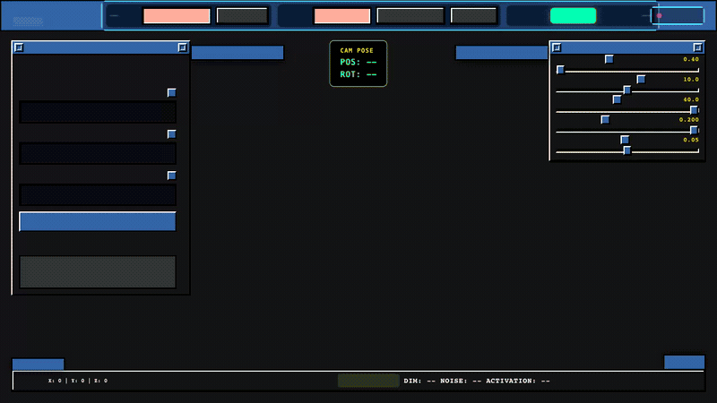

# VHectorLab 3D

**A local study / laboratory tool for exploring semantic embeddings in 3D (WebGL). Not a production SaaS.**


Visualización 3D interactiva en tiempo real (WebGL / Three.js), álgebra vectorial semántica (`A − B + C`), secuencias comparativas multilingües, filtrado de ruido estructural y análisis espectral de alta precisión.

| | |
| :--- | :--- |
| **Versión** | **v4.1.1** (Magic Workbench & Structural Noise Shield) |
| **Licencia** | [Apache-2.0](./LICENSE) © 2026 Hector Bauzan |
| **Public Demo** | [Hugging Face Space](https://huggingface.co/spaces/hbauzan/llm-semantic-visualizer) *(cpu-basic / Arctic-m-v2)* |
| **Local (macOS)** | `./setup.sh` → opción `1` → http://127.0.0.1:5173 |
| **Plataforma** | Creado y validado para macOS Apple Silicon (Darwin / MPS) |

---

## 🔬 1. Quórum Espectral: Excitación de Dimensiones por Temática — *El alma de las palabras*

> *"¡LA PUTA MADRE AHORA SÍ CARAJO SE VE LO QUE TENÍA EN LA CABEZA HACE MESES! Las diferencias entre mazos de palabras están en los decimales finos."*

Durante meses nos preguntamos por qué conceptos de universos dispares —como fierros de autos (`VEHICLES`), nombres de personas (`WOMEN`) o arquitectura de software (`IT_CORE`)— parecían una masa indistinguible en las proyecciones visuales clásicas de embeddings. Una IA anterior me tuvo desviado casi seis meses persiguiendo un recorte artificial tipo hongo que mataba la señal real.

La causa no era la matemática de fondo, sino el fuerte **modo común** y la estructura sintáctica compartida que domina los espacios densos como `BAAI/bge-m3` (1024 dimensiones). La verdadera firma semántica que distingue a cada mazo de palabras se encuentra en las dimensiones de alta separabilidad estadística ($S_d$), operadas en `Float64` con cero redondeos siguiendo el estándar **DDI-FW**.

### Principios del Quórum Espectral (Alineación DDI-FW):
- **Separabilidad Pairwise Nearest-Competitor con Signo ($S_d$)**: Evalúa la envoltura bilateral $\max(\min_{h \neq g} S_h^+, \min_{h \neq g} S_h^-)$ según `ddi-fw` (`cruce.py`), detectando firmas tanto por elevación (+1) como por depresión (−1).
- **Auto-calibración Nula Westfall–Young maxT ($M=1000$)**: El umbral de admisión $p_{95}$ se deriva no paramétricamente por permutaciones en tiempo real ($O(N_{\min} \cdot D)$, ~25 ms en Float64) controlando el error familiar (FWER). Garantiza **estrictamente 0 dimensiones admitidas sobre ruido aleatorio**, sin umbrales mágicos hardcodeados.
- **Polaridad Bicolor No Colisionante**: Excitación (+1, Cian Eléctrico `#00E5FF`) y depresión (−1, Rosa Neón `#FF3366`), desacopladas de la rampa base sin colisionar con amarillo, violeta ni ámbar.
- **Fallback No Destructivo**: Quórum vacío ($S_d < p_{95}$ o $N < 3$) conserva la rampa divergente estándar sin apagar la escena a negro.
- **Auditoría e Inspección en Tiempo Real**: Readout interactivo al clickear (`Dim X — G1: A/B vs G2: C/D; Sd = S vs umbral nulo U`) y exportación auditable CSV/JSON con precisión Float64 exacta (`toPrecision(17)`).

#### 1.1. Vista frontal en ANALYSIS: Picos fijos de excitación temática y silencio base


*Fijate acá:* tres grupos en paralelo (`IT_CORE`, `VEHICLES`, `WOMEN`). Con **Baseline silence** al 100%, el ruido común y las dimensiones sin separabilidad se mandan a negro absoluto. Lo que queda encendido son columnas verticales representativas: cada temática destaca en las dimensiones que la diferencian del resto, permitiendo aislar con nitidez las coordenadas clave de cada universo semántico.

#### 1.2. Órbita 3D en NAVIGATION: Relieve y aislamiento espectral


*Metete adentro del espacio:* en modo `NAVIGATION` rotás la cámara y ves el relieve tridimensional real de los 1024 tensores de BGE-M3. Las dimensiones activas se elevan como rascacielos mientras el ruido silenciado descansa en el piso.

#### 1.3. Barrido de Decimal Gain: El microscopio vectorial


*Mirá cómo enfoca:* arrancamos con ganancia baja y barremos el `Decimal Gain` (hasta 50×) y el `Baseline silence`. Funciona como la perilla de enfoque de un microscopio: amplifica el contraste relativo de la señal discriminante sobre el fondo silenciado, revelando la estructura interna de los grupos en el orden de $10^{-4}$ a $10^{-6}$.

---

## 🛡️ 2. Universal Structural Noise & Outlier Pruning Shield (v4.0 / v4.1)

En modelos de embeddings continuos basados en Transformers (`bge-m3`, `all-mpnet-base-v2`, `MiniLM`), el espacio vectorial **no es isotrópico**. Debido a dinámicas de LayerNorm y residual streams, una fracción diminuta de coordenadas (<1.3% del total) desarrolla un offset DC permanente de saturación extrema o se vuelve completamente inerte.

### La evidencia empírica en tensores reales:
En `BAAI/bge-m3` (10.338 palabras × 1024 dimensiones):
- **13 coordenadas aisladas** concentran el **19.80% de la energía $L_2^2$ total** de todo el vocabulario.
- Coordenadas canallas como `Dim 386` ($Z_E = 19.74$, **12.2× la energía promedio**) o `Dim 297` ($Z_E = 11.28$) generan un piso artificial de similitud coseno de $\approx 0.50$ entre palabras totalmente dispares.
- En tokens individuales, la energía secuestrada por el ruido es brutal: en `car` el ruido estructural representa el **24.7%** de su longitud vectorial al cuadrado; en `truck`, el **19.2%**.

```
┌────────────────────────────────────────────────────────────────────────┐
│ ENGINE MANAGER: BAAI/bge-m3 (1024-D)                                   │
│ Saturated: [38, 58, 65, 80, 297, 376, 386, 404, 549, 577, 780]        │
│ Flat / Inert: [329, 616]                                               │
│ Energy Monopoly: 19.80% L2  │  Cosine Floor Drop: Δ = -0.1152          │
└────────────────────────────────────────────────────────────────────────┘
```

### Cómo lo resuelve el laboratorio:



*Fijate en el Engine Manager y el ribbon fantasma:* Al activar el **Outlier Shield**, las dimensiones canallas se aplanan a cero sin recalcular la malla. Si prendés el **Dual-Path Ribbon**, aparece la cinta fantasma durazno (`#FFA997`) mostrando la deformación original en el aire mientras el hilo real viaja limpio por el piso, y el HUD te canta el porcentaje exacto de energía de ruido que tenía cada palabra.

1. **Detección Dinámica Modelo-Aware**: El motor (`backend/structural_noise.py`) clasifica en caliente outliers saturados ($Z \ge 3.0$) y canales planos ($\sigma \le 0.010$). Cero dimensiones hardcodeadas: los perfiles se auditan y cachean por modelo en RAM y disco.
2. **Outlier Shield en Vertex Shader GLSL**: Al activar el escudo, las coordenadas de ruido estructural se aplastan contra el baseline en tiempo real directamente en la GPU (`aNoiseMask`, `aBaselineY`, `uShieldEnabled`) a 60 FPS, sin reasignar buffers ni consumir memoria extra.
3. **Dual-Path Ghost Ribbon**: Una cinta translúcida color durazno (`#FFA997`, opacidad 0.28) recorre la trayectoria cruda deformada por el ruido, mientras la cinta principal traza la geometría semántica limpia.
4. **Telemetría de Ruido en Vivo (`NOISE:`)**: El HUD inferior inspecciona cada token al pasar el cursor y muestra su ratio exacto de energía de ruido $\|e_{\text{noise}}\|_2^2 / \|e\|_2^2$.

---

## 🌌 3. Álgebra Vectorial, UMAP Galaxy & Top-K SAE

Más allá del análisis espectral y de ruido, VHectorLab 3D es una estación de trabajo completa para diseccionar la geometría del lenguaje:


- **Vector Arithmetic en Vivo ($A - B + C$)**:
  Calculá trayectorias semánticas como `rey − hombre + mujer = reina` en tiempo real contra matrices pre-computadas de vocabulario en RAM, con búsqueda de vecinos más cercanos por producto punto en submilisegundos.
- **Modo UMAP Galaxy**:
  Navegación espacial inmersiva (vuelo WASD / QE + mouse look) sobre proyecciones UMAP globales. Los tokens se representan como estrellas con halos suaves calculados por shaders, permitiendo explorar constelaciones temáticas completas.
- **Top-K Sparse Autoencoders (SAE - Interpretabilidad Mecanística)**:
  Entrenamiento en RAM de autoencoders dispersos sobre secuencias activas de tokens (con exactamente $K=32$ latentes activos, activación ReLU sin contracción L1). Expande el espacio denso (768D / 1024D) a un espacio de características dispersas de 8192 dimensiones, aislando conceptos monosemánticos y eliminando features muertas.

---

## 🕹️ 4. La Estética: Magic Workbench Chassis (v4.1.1)

VHectorLab 3D no parece un dashboard web genérico de 2026 hecho con plantillas infladas. Su interfaz está inspirada en la legendaria arquitectura **Amiga Intuition / Magic Workbench 3.1** (Martin Huttenloher, 1993):

- **Ventanas con Biseles 3D Reales**: Chasis con bordes en relieve blanco/negro y sombras sólidas de 2px, barra de título cobalto de 24px y gadgets clásicos de profundidad y colapso.
- **Docking Perimetral**: Docks colapsables en los bordes (`◀ ARITHMETIC`, `◀ COMPARE`, `SPATIAL ▶`, `▼ ENGINE`, `▼ VIZ`) que liberan el canvas WebGL para mantener el foco en la escena 3D.
- **Diálogos EasyRequest**: Alertas y confirmaciones del sistema emuladas con precisión de pixel, botones con gadget-press táctil (traslación de 1px y bisel invertido).
- **Cero Framework Bloat**: Construido en HTML semántico, Vanilla CSS de alto rendimiento y WebGL nativo con Three.js, garantizando 60 FPS estables sin Electron ni sobrecargas.

---

## 🌐 Public Demo (Hugging Face Spaces)

Podés probar la demo pública sin instalar nada:

👉 **[https://huggingface.co/spaces/hbauzan/llm-semantic-visualizer](https://huggingface.co/spaces/hbauzan/llm-semantic-visualizer)**

*Nota: La instancia pública corre en CPU (`cpu-basic`) dentro de un contenedor Docker sobre Hugging Face Spaces (modelo `Snowflake/snowflake-arctic-embed-m-v2.0` truncado a 256D con vocabulario bilingüe EN∪ES). Tiene arranque en frío y recursos limitados. Para trabajo analítico pesado o cambio de modelos, ejecutalo localmente.*

---

## 🚀 Quick Start (macOS)

Todo el ciclo de vida del laboratorio se gestiona mediante el panel interactivo `./setup.sh`. En macOS, el instalador detecta e instala dependencias faltantes (`uv`, Node/npm vía Homebrew, paquetes de Python y frontend).

```bash
# 1. Clonar el repositorio
git clone https://github.com/hbauzan/vhectorlab.git
cd vhectorlab

# 2. Iniciar el panel de control
chmod +x setup.sh   # primera vez
./setup.sh
```

Seleccioná la **opción `1`** (`Deploy / Start Tool`):
- Comprueba la salud del backend (`:8000`) y frontend (`:5173`).
- Si todo está sano, abre directamente el navegador en **http://127.0.0.1:5173**.
- Si falta compilar o sincronizar, descarga dependencias (`uv sync`, `npm install`), genera vocabularios, corre tests unitarios y arranca ambos servicios.
- Podés pausar los logs en vivo con `Ctrl+C` (los servicios siguen corriendo en segundo plano).
- Para detener los servicios limpiamente: elegí la opción **`10`** del menú.

---

## 🧠 Catálogo de Modelos & Hardware Benchmark

Desde `./setup.sh` → **opción `11`** podés alternar el modelo activo del laboratorio:

| Perfil / Modelo | Dimensiones | Memory Tier | Idiomas | Enfoque |
| :--- | :--- | :--- | :--- | :--- |
| **`BAAI/bge-m3`** | 1024-D | Full (>1.5 GB) | Multilingüe | Máxima discriminación temática (DDI-FW / Quórum) |
| **`all-mpnet-base-v2`** | 768-D | Medium (500MB–1.5GB) | EN | Baseline de alta precisión semántica |
| **`snowflake-arctic-embed-m-v2.0`** | 256-D (Matryoshka) | Medium | EN + ES | Modelo rápido y eficiente optimizado para CPU |
| **`paraphrase-multilingual-MiniLM-L12-v2`**| 384-D | Light (<500 MB) | Multilingüe | Ultra liviano para pruebas rápidas |

### Benchmark de Hardware en Tiempo Real:
El menú evalúa la RAM libre de tu máquina antes del cambio para evitar swaps riesgosos (Memory Gate con aviso explícito si la memoria está ajustada). Además, podés tipear `B` o `B all` para correr un micro-benchmark local (`scripts/benchmark_models.py`) que mide:
- Tiempo de carga en frío y warmup.
- Throughput de inferencia en caliente (palabras/segundo sobre una muestra calibrada de 500 palabras).
- Proyección lineal de tiempo para reconstruir la matriz completa `vocab_en_es.npz`.

---

<details>
<summary>🛠️ <b>Caja de Herramientas Técnica (Opciones Avanzadas)</b></summary>

### Menú de `setup.sh`
- `1`: Deploy / Start completo (idempotente).
- `2`: Levantar solo Backend (`:8000`).
- `3`: Heartbeat / Chequeo de salud del stack.
- `4`: Tests unitarios frontend (Vitest).
- `5`: Tests unitarios backend (Pytest).
- `6`: Generar o cargar vocabulario personalizado.
- `7`: Build local de imagen Docker para Hugging Face Spaces.
- `8`: Publicar actualización a Hugging Face Space (con frontmatter automático).
- `9`: Ver logs en vivo del backend.
- `10`: Detener / Limpiar servicios por completo (kill ports 8000/5173).
- `11`: Selector de Modelo / Perfil y Benchmark de hardware.
- `12`: **Dump Context & Codebase** (`vhectorlab-context.txt` para análisis en LLMs).

### Variables de Entorno (`.env`)
Se generan automáticamente desde `.env.example` en el primer inicio:
- `HOST` / `PORT`: Dirección y puerto de escucha (default `127.0.0.1:8000`).
- `MODEL_NAME`: Identificador del modelo SentenceTransformers activo.
- `VOCAB_PATH`: Archivo de vocabulario (usar `public/vocab_en_es.txt` para soporte bilingüe EN∪ES).
- `VITE_API_BASE_URL`: URL base de la API para el cliente web (`/api`).
- `VITE_AMIGA_*`: Paleta de colores personalizable del tema Magic Workbench.

### Inicio Manual (sin setup.sh)
```bash
# Terminal 1: Backend
cd backend
uv sync --extra dev
uv run python -m server

# Terminal 2: Frontend
npm install
npx vite --port 5173 --host 127.0.0.1
```

### Solución de Problemas Frecuentes
- **Puerto ocupado o servicio colgado**: Usá la opción `10` de `./setup.sh` para matar procesos residuales y reintentá con la opción `1`.
- **Falta de herramientas tras instalación**: Abrí una nueva terminal para refrescar el `PATH` del shell.
- **Docker daemon not running en opción 7**: Asegurate de tener Docker Desktop abierto y en ejecución.

</details>

---

## 📄 Licencia & Reconocimientos

Distribuido bajo licencia **Apache License 2.0**. Consultá los archivos [LICENSE](./LICENSE) y [NOTICE](./NOTICE) para más detalles.

Desarrollado por **Hector Bauzan** (2026) como una herramienta artesanal de estudio, investigación y visualización geométrica del lenguaje.
