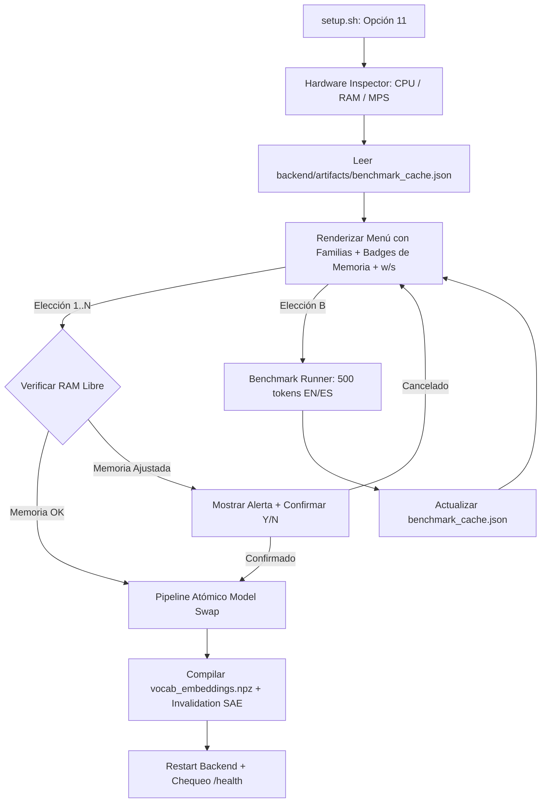

# Roadmap: Selector Inteligente de Embeddings y Benchmark de Hardware Local

**Estado:** BORRADOR (En diseño conjunto con el usuario)  
**Fecha:** 2026-10-25  
**Área:** `setup.sh`, `scripts/`, `backend/model_catalog.py`, `backend/model_swap.py`, `backend/`  
**Referencia:** Protocolo de desarrollo (`.agents/skills/dev-protocol/SKILL.md`) — Rol Principal Architect  

---

## 1. Principio Rector y Visión

Evolucionar la herramienta de administración y despliegue local ([`setup.sh`](../setup.sh) Opción 11) de un catálogo estático a un **gestor inteligente consciente del hardware** (*hardware-aware*) con capacidad de **micro-benchmarking local**.

### Principios no negociables:
1. **Fidelidad al Dominio de Embeddings**: Se restringe exclusivamente a modelos densos de representación semántica continua (`SentenceTransformers` compatibles). Quedan excluidos LLMs generativos autorregresivos en este pipeline para preservar la isotropía espacial y evitar el colapso dimensional en 3D.
2. **Consciencia de Hardware sin Conjeturas**: Antes de sugerir o permitir el cambio de un modelo, el sistema inspecciona la memoria RAM libre real, el tipo de chip/CPU y el estado de aceleración de tensores (`mps` en Apple Silicon, `cuda` en Linux/Windows o `cpu`).
3. **Benchmarking No Destructivo**: La evaluación empírica de throughput (palabras/seg) y consumo de memoria se ejecuta de forma aislada sin modificar el `.env` activo ni requerir reescrituras de tensores de producción hasta que el usuario confirme la selección.
4. **Respeto a los Contratos Existentes**: Preservar el pipeline atómico de swap ya probado: merge EN∪ES, compilación de `vocab_embeddings.npz`, invalidación de SAE ante cambio de dimensión $D$, y verificación en `/health`.

---

## 2. Decisiones de Diseño Ratificadas

Las siguientes decisiones arquitecturales fueron evaluadas y aprobadas en conjunto con el usuario:

### Decisión 1: Estrategia del Inspector de Hardware
* **Seleccionada**: **Módulo Python nativo (`backend/hardware_inspector.py`) con `psutil` + `torch.backends` + `platform`**.
  * *Rationale*: Multiplataforma limpia (macOS MPS, Linux/Windows CUDA/CPU), mide RAM libre en tiempo real en bytes y el runtime de PyTorch confirma el acelerador sin dependencias binarias pesadas.
  * *Contrato*: Expone `get_hardware_profile() -> HardwareProfile` con campos tipados: `platform`, `cpu_brand`, `cpu_cores`, `total_ram_bytes`, `available_ram_bytes`, `accelerator` (`mps` | `cuda` | `cpu`), `accelerator_device_name`, y `verdict_tier`.

### Decisión 2: Metodología del Motor de Benchmark Local
* **Seleccionada**: **Micro-benchmark in-memory con mazo sintético controlado (500 tokens EN/ES)**.
  * *Rationale*: Mide throughput (w/s), tiempo de carga en frío (s) y RAM pico (MB) en menos de 4 segundos por modelo, proyectando con exactitud el tiempo de compilación del vocabulario completo de 10.338 palabras sin saturar el sistema.
  * *Métricas*:
    1. `cold_load_sec`: Latencia de subida de pesos a memoria/GPU.
    2. `throughput_wps`: Palabras por segundo procesadas en batch.
    3. `peak_ram_mb`: Incremento neto de memoria RSS/MPS durante la inferencia.
    4. `estimated_vocab_sec`: Proyección $T = \frac{10.338}{\text{throughput}} + \text{overhead}$.

### Decisión 3: Estructura y Taxonomía del Catálogo
* **Seleccionada**: **Dataclasses inmutables tipadas en `backend/model_catalog.py`**.
  * *Rationale*: Mantiene la fuente de verdad única en Python donde ya residen los adapters de E5, Matryoshka y tokens. Garantizado por tests unitarios y extensible con pocas líneas de código.
  * *Taxonomía*:
    - **Familias**: `BAAI`, `Snowflake`, `Alibaba`, `Intfloat_E5`, `UKPLab`, `Google`.
    - **Tiers de Memoria**: `LIGERO` (< 500 MB), `MEDIO` (500 MB – 1.5 GB), `COMPLETO` (> 1.5 GB).

### Decisión 4: Flujo de Acceso al Benchmark en Terminal
* **Seleccionada**: **Sub-acción interactiva `[B]` en el menú de la Opción 11 de `setup.sh`**.
  * *Rationale*: Mantiene el selector ágil para cuando solo se desea cambiar de modelo sin esperar, y permite correr el benchmark (de un modelo individual o de toda la lista) únicamente cuando el usuario desea comparar rendimientos.
  * *Comandos*: `choice: [1..N]` ejecuta el swap; `choice: B` o `benchmark` abre el submenú de benchmark; `choice: B <id>` ejecuta el benchmark específico de ese modelo.

### Decisión 5: Política de Semáforo de Memoria
* **Seleccionada**: **Advertencia con confirmación explícita (Soft-gate)**.
  * *Rationale*: Muestra una alerta visual clara (`⚠️  ALERTA: Memoria libre ajustada (Req: ~2.2 GB / Libre: 1.1 GB)`), pero no bloquea ciegamente al usuario, permitiéndole forzar la selección si sabe que puede liberar memoria o cerrará aplicaciones antes de arrancar.
  * *Tiers de Advertencia*:
    - `🟢 ÓPTIMO`: Memoria libre $\ge 2 \times$ peso del modelo.
    - `🟡 AJUSTADO`: Memoria libre entre $1 \times$ y $2 \times$ peso del modelo.
    - `🔴 ALERTA`: Memoria libre $< 1 \times$ peso del modelo (requiere confirmación adicional).

### Decisión 6: Persistencia y Caché de Resultados
* **Seleccionada**: **Caché persistente en `backend/artifacts/benchmark_cache.json`**.
  * *Rationale*: Guarda los resultados medidos localmente para mostrar la columna de Throughput (`w/s`) directamente en el menú de `setup.sh` sin tener que re-ejecutar el test en cada apertura. Se invalida o actualiza cuando el usuario vuelve a correr el benchmark con `B`.

---

## 3. Especificación Técnica y Contratos

### 3.1. Contrato del Hardware Profile (`backend/hardware_inspector.py`)
```python
@dataclass(frozen=True, slots=True)
class HardwareProfile:
    platform_name: str          # e.g. "Darwin" / "Linux"
    cpu_brand: str              # e.g. "Apple M4" / "AMD Ryzen 9"
    cpu_cores: int              # e.g. 10
    total_ram_bytes: int        # e.g. 17179869184 (16.0 GB)
    available_ram_bytes: int    # e.g. 10982736128 (10.2 GB)
    accelerator: str            # "mps" | "cuda" | "cpu"
    accelerator_device_name: str # e.g. "Apple Metal (MPS)" / "NVIDIA RTX 4090"
    is_accelerated: bool        # True if mps or cuda
```

### 3.2. Contrato del Benchmark Result (`backend/benchmark_runner.py`)
```python
@dataclass(frozen=True, slots=True)
class ModelBenchmarkResult:
    hub_id: str
    short_label: str
    family: str
    device: str
    cold_load_sec: float
    throughput_wps: float       # words per second
    peak_ram_mb: float
    estimated_vocab_sec: float  # for 10,338 words
    timestamp_utc: str
```

### 3.3. Estructura del Catálogo Enriquecido (`backend/model_catalog.py`)
```python
class ModelFamily(str, Enum):
    BAAI = "BAAI"
    SNOWFLAKE = "Snowflake"
    ALIBABA = "Alibaba"
    INTFLOAT = "Intfloat (E5)"
    UKPLAB = "UKPLab (Sentence-Transformers)"
    GOOGLE = "Google"

class MemoryTier(str, Enum):
    LIGHT = "LIGERO (<500MB)"
    MEDIUM = "MEDIO (500MB-1.5GB)"
    FULL = "COMPLETO (>1.5GB)"
```

---

## 4. Arquitectura y Flujo de Ejecución



---

## 5. Slices de Ejecución Planificados (TDD)

### Slice 1: Hardware Inspector & Taxonomía de Familias
* **Estado:** implementado. El perfil vigente es el de §3.1 (`platform_name`, `is_accelerated`). La Decisión 1 también nombra `verdict_tier`; ese semáforo no es un campo de `HardwareProfile` y queda para el Slice 3.
* **Objetivo**: Crear el módulo de detección de hardware en Python y estructurar el catálogo por familias y tiers de memoria.
* **Archivos a modificar / crear**:
  - `backend/hardware_inspector.py` (nuevo)
  - `backend/model_catalog.py`
  - `backend/tests/test_hardware_inspector.py` (nuevo)
  - `backend/tests/test_model_catalog.py`
* **Tests unitarios TDD**:
  - Detección precisa de RAM total/disponible $> 0$.
  - Detección correcta de acelerador (`mps` en macOS arm64, `cuda` en GPU Linux, `cpu` como fallback).
  - Todos los modelos del catálogo asignados a una familia y tier de memoria válidos.

### Slice 2: Micro-Benchmark Runner & Persistencia de Resultados
* **Objetivo**: Implementar la rutina de prueba de carga, throughput y memoria con payload controlado de 500 tokens y serialización JSON.
* **Archivos a modificar / crear**:
  - `backend/benchmark_runner.py` (nuevo)
  - `scripts/benchmark_models.py` (nuevo CLI)
  - `backend/tests/test_benchmark_runner.py` (nuevo)
* **Tests unitarios TDD**:
  - Ejecución in-memory en $< 5$ segundos para un modelo liviano (MiniLM).
  - Métricas numéricas consistentes (`throughput_wps > 0`, `cold_load_sec > 0`).
  - Escritura y lectura atómica de `backend/artifacts/benchmark_cache.json`.

### Slice 3: Integración en `setup.sh` & Soft-Gate de Memoria
* **Objetivo**: Conectar el inspector, el semáforo de advertencia y el subcomando `[B]` en el flujo interactivo de `setup.sh` Opción 11.
* **Archivos a modificar**:
  - `setup.sh`
  - `scripts/select_embedding_model.py`
  - `backend/model_swap.py`
  - `tests/select_embedding_model_cli.test.js` / test de integración
* **Tests unitarios y manuales**:
  - Renderizado visual del banner de hardware y las columnas de familia/throughput en terminal.
  - Comportamiento de soft-gate cuando el modelo solicitado excede la memoria disponible.
  - Flujo de swap completo verificado contra `/health`.

---

## 6. Criterios de Aceptación y Entrega

1. **Detección Automática No Conjetural**: `setup.sh` muestra en vivo CPU, RAM disponible y estado del acelerador (`mps`/`cuda`/`cpu`) con datos reales medidos por Python.
2. **Semáforo de Compatibilidad**: Modelos que superen la RAM libre del sistema emiten una advertencia visual clara y requieren confirmación explícita.
3. **Benchmark Rápido y Fiable**: La sub-acción `[B]` evalúa el modelo en $< 4$ segundos y almacena los resultados en `benchmark_cache.json`.
4. **Cero Regresiones**: El pipeline de producción (`deploy_and_start`, `/health`, shaders WebGL y Spectral Quorum) permanece 100% operativo con la suite de pruebas en verde.

